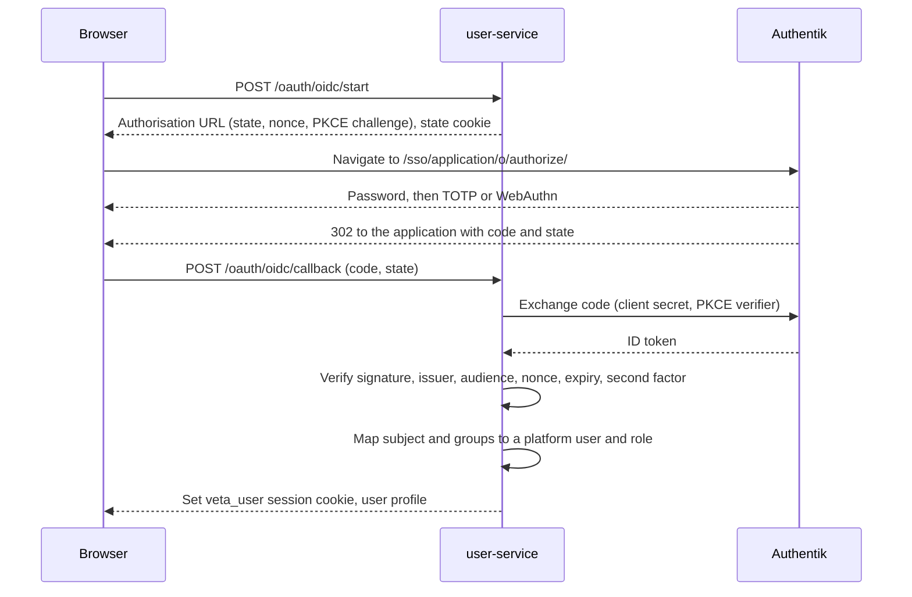

**Status:** Accepted

**Date:** 2026-11-12

## Context

`user-service` is the platform's own small OAuth 2.0 server. A client posts a user ID and a
passcode to `/oauth/authorize` with a PKCE challenge, exchanges the code at `/oauth/token`, and
receives an eight hour session carried in the `veta_user` cookie. The gateway validates that
session against `user-service` on every request.

Production runs in demo mode. The sign-in page lists the demo personas and is handed each
persona's passcode, so a visitor enters the platform with one click. Public registration is on.
The administrator persona is in that list, and nothing offers a second factor.

Two rows on the [Professional Standards](../../professional-standards/) page are deferred on
this: sign-in against an external identity provider, and multi-factor authentication
([#974](https://github.com/milesburton/veta-trading-platform/issues/974)).

## Decision

1. **Identity provider.** Self-hosted [Authentik](https://goauthentik.io/), with TOTP or
   WebAuthn required for every account it holds.
2. **Who must use it.** Named accounts sign in through Authentik. The `admin` role can be held
   only by an account that signed in through Authentik. Local sign-in refuses it.
3. **Demo personas stay.** One-click demo sign-in remains for the non-administrator personas, and
   the sign-in page labels it as a demonstration. Demo personas keep their current roles and
   limits.
4. **Machine accounts stay local.** Synthetic traders, the synthetic probe and the load
   generator keep the `veta-automation` client and their passcodes from OpenBao.
5. **Public registration is switched off.** New named accounts are created by an administrator
   in Authentik. Guest mode is unchanged and remains off by default.
6. **Address.** Authentik is served under a path on the existing host name, `/sso/`, so there is
   no new DNS record or certificate.
7. **Hosting.** Authentik runs on the platform's own server as a separate Compose project, in
   the same pattern as OpenBao, with its own PostgreSQL container.

## Sign-in flow

`user-service` remains the only issuer of platform sessions. It becomes an OIDC relying party
and treats Authentik as the source of identity and of the second factor.

The browser reaches `user-service` through the gateway as JSON requests, as it does for local
sign-in, so the flow returns the authorisation URL for the application to follow and the
provider redirects back to the application, which posts the code. The gateway forwards only the
`veta_oidc_state` cookie on POST requests, so the callback can match the state it issued.

| Concern | Handling |
| --- | --- |
| Front and back channel | The browser uses the public `/sso/` path. `user-service` calls the token and key endpoints by container name over `trading-net`, and still requires the token's issuer to equal the public issuer. |
| Client type | Confidential client with PKCE. The client secret lives in OpenBao. |
| Token checks | Signature against the provider's published keys, issuer, audience, nonce, expiry. Only the authorisation code flow is accepted. |
| User mapping | The Authentik user name maps to one row in `users.users`, created on first sign-in and marked as externally authenticated. Such a row has no local passcode and cannot use local sign-in, and a name already held by a local account is refused. |
| Roles | Taken from Authentik group membership (`veta-admin`, `veta-trader` and so on) and refreshed at each sign-in. An account in no platform group receives `viewer`. |
| Second factor | Enforced by the Authentik authentication flow: an account without a registered device is made to enrol one before the flow completes. `user-service` also refuses an ID token whose `amr` claim does not record a second factor. |
| Session | Unchanged: the eight hour `veta_user` cookie, validated by the gateway. Signing out also ends the Authentik session. |
| Break glass | Setting `OIDC_ENABLED=false` in OpenBao and redeploying restores local administrator sign-in. It needs access to the server. |

## Hosting

| Item | Choice |
| --- | --- |
| Containers | `server`, `worker` and `postgresql`, from the upstream Compose file. Current releases need no Redis. |
| Networks | `server` joins `trading-net` so Traefik and `user-service` reach it by name. The database sits on a network private to the project. Both are internal, so Authentik has no route to the internet. |
| Outbound calls | Update check and error reporting are disabled. The worker does not mount the Docker socket, because no outposts are deployed. |
| Configuration | The provider, application, groups and the MFA-enforcing flow are declared as a blueprint in the repository, so the setup is reviewed and reproducible. |
| Secrets | Secret key, database password, bootstrap administrator credential and the OIDC client secret live in OpenBao. |
| Routing | A Traefik router for `PathPrefix(/sso)` forwards the prefix unchanged. Authentik is told its path with `AUTHENTIK_WEB__PATH=/sso/`. |
| Footprint | About 1.5 to 2 GB of memory. Memory and CPU limits are set on each container. |

## Rollout

Each step is deployable on its own and leaves sign-in working.

1. Authentik project, Traefik route and blueprint. It stays down until its secrets exist in
   OpenBao.
2. `user-service` OIDC start and callback, user mapping, and a single sign-on button on the
   sign-in page. Disabled unless `OIDC_ENABLED=true`.
3. Enable in production, enrol the administrator, confirm the second factor is demanded.
4. Refuse local sign-in for `admin`, remove the administrator from the demo list, switch public
   registration off, and update the Professional Standards rows. Done: `LOCAL_ADMIN_SIGN_IN` and
   `OAUTH_ALLOW_PUBLIC_REGISTER` both default to false and the registration form is removed.

## Alternatives considered

| Option | Why not |
| --- | --- |
| Keycloak, self-hosted | Does the same job with a larger memory footprint and a heavier configuration model than this platform needs. |
| Hosted identity provider | Adds a paid third party to the sign-in path and a dependency outside the server. |
| All sign-in through Authentik, no demo personas | Ends one-click entry, which is the purpose of the public demonstration. |
| Authentik only in front of operational tools | Leaves the platform's own administrator role on a published passcode. |
| MFA built into `user-service` | Reimplements enrolment, recovery and device management that an identity provider already does well. |
| A subdomain for Authentik | The conventional layout, but needs a DNS record, an edge route and a certificate for no functional gain here. |
| Hosting on a second server | Spare CPU, but `user-service` would need a route off the internal network and sign-in would depend on two hosts. |

## Consequences

- Sign-in for named accounts depends on Authentik being up. Demo personas and machine accounts
  do not.
- The demo personas remain a shared, published credential by design. They cannot hold `admin`,
  so the exposure is limited to what a demonstration user can already do.
- Authentik's database needs to be included in the backup job.
- Grafana and the Traefik dashboard keep their current authentication. Moving them behind
  Authentik is a possible later step and is not part of this decision.
- Authentik upgrades become a maintenance task. The image tag is pinned and raised by reviewed
  pull request.
