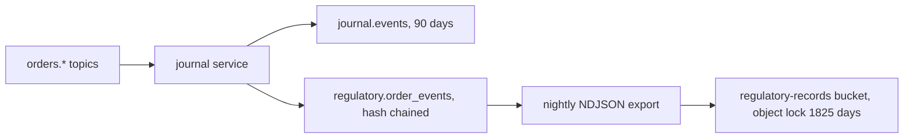

The platform is a simulator. It produces the data shapes, controls and evidence a regulated firm would keep under MiFID II, but it makes no claim of legal compliance and submits nothing to an Approved Reporting Mechanism.

## Regulatory identifiers on orders

The OMS stamps regulatory identifiers on `orders.submitted` and `orders.routed`. The EMS adds the algorithm identifier to `orders.filled`. The journal keeps the full payload of every event, so reports can be rebuilt from stored records.

| Field | Source | Notes |
| --- | --- | --- |
| `algoId`, `algoVersion` | `shared/algoRegistry.ts` | Set for algorithmic strategies only. `LIMIT` is not treated as an algorithm. |
| `orderType` | OMS | `LIMIT` when a limit price is present, otherwise `MARKET`. |
| `lei` | `FIRM_LEI` environment variable | Executing entity. Dropped unless it matches the 20 character LEI format. |
| `clientCode` | `users.trading_limits.client_code` | Pseudonymous code. Falls back to the user id. |
| `decisionMakerCode` | `users.trading_limits.decision_maker_code` | Investment decision within the firm. Falls back to the user id. |
| `executionDecisionCode` | OMS | The algorithm identifier when an algorithm executes the order, otherwise the decision maker code. |

No national identifiers are stored. Codes are pseudonyms that an operator maps to natural persons outside the platform.

## Algorithm registry

Every strategy has a registry entry with a stable identifier and a semantic version. Bump the version in `shared/algoRegistry.ts` whenever an algorithm's behaviour changes, so that fills and test records can be tied to the code that produced them.

## Journal behaviour

Fill events are keyed by execution id, so repeated partial fills of one child order are all retained. Previously only the first fill of a child was stored.

## Order record and retention

Every order lifecycle event (`orders.submitted`, `orders.routed`, `orders.child`, `orders.filled`, `orders.expired`, `orders.rejected`, `orders.cancelled`) is written twice by the journal service. The regulatory write happens before the Kafka offset is acknowledged: the journal consumer for these topics does not advance past a message until the insert has succeeded, so a database outage pauses consumption rather than dropping records. Rejections carry no order id, so their record id is derived from the client order id.

| Store | Purpose | Retention | Mutable |
| --- | --- | --- | --- |
| `journal.events` | Hot store for the UI, replay and latency metrics | 90 days (`JOURNAL_RETENTION_DAYS`, with optional dry-run mode via `JOURNAL_RETENTION_DRY_RUN`) | Yes, pruned |
| `regulatory.order_events` | Legal order record | Not pruned | No |

`regulatory.order_events` follows the same pattern as `audit.events`. Rows form a SHA-256 hash chain, triggers reject `UPDATE`, `DELETE` and `TRUNCATE`, and the writer role can only insert and select. The journal writes through the existing `veta_audit` login, so no additional secret is introduced. Each row keeps the full event payload, including the regulatory identifiers stamped in the previous step.

The journal exports each completed UTC day to the `regulatory-records` bucket every six hours as immutable segments named `orders/YYYY/MM/DD/<firstSeq>-<lastSeq>.ndjson`. On each run it reads the highest exported sequence for the day from the existing segment names and writes a new segment for any records above it, so a record that arrives late (delayed delivery or archive reconciliation) within the three day lookback is appended as a further segment rather than lost. The bucket is created with object lock and a default COMPLIANCE retention of 1825 days (five years). The export needs `MINIO_ENDPOINT`, `MINIO_ROOT_USER` and `MINIO_ROOT_PASSWORD` on the journal service and is disabled when they are absent.

Integrity checks are exposed by the journal at `/regulatory/verify` and `/regulatory/head`. The retention runbook is [Regulatory record retention](https://github.com/milesburton/veta-trading-platform/blob/main/docs/incidents/runbooks/regulatory-retention.md).

This is a simulation. Five year retention here means the controls exist and are tested, not that the deployment meets a regulator's availability or audit requirements. Postgres backups default to 14 days (`POSTGRES_BACKUP_RETENTION_DAYS`), so the object-locked export, not the backup, is the long-term copy.

## Clock synchronisation and timestamps

RTS 25 requires the clocks used to timestamp reportable events to stay within a stated divergence from UTC: 1 ms for algorithmic trading, 100 microseconds for high frequency techniques and one second for other activity.

| Piece | Behaviour |
| --- | --- |
| `backend/src/lib/clock.ts` | `nowMicros()` returns epoch microseconds from a wall clock anchor plus the monotonic clock. When the host clock steps by more than 5 ms (a `chronyc makestep`, a VM resume) the anchor is re-taken on the next call, so a forward step applies at once and a backward step never makes a later timestamp smaller: the value holds until the corrected clock passes it. A minimal SNTP client measures offset from a reference, rejecting replies that are unsynchronised (leap indicator 3), not in server mode, or at stratum 0 or 16, and timing the exchange from after the socket has connected so DNS and socket setup are not counted as transit |
| Gateway monitor | When `NTP_SERVER` is set the gateway queries it every minute and records `veta_clock_offset_microseconds` and `veta_clock_sync_healthy` |
| `ClockDriftHigh` | Warns when the absolute offset stays above 1000 microseconds for 5 minutes, mirrored in Grafana |
| `ClockSyncUnavailable` | Warns when the reference cannot be reached for 15 minutes |
| `tsMicros` | Stamped by the OMS on accepted orders and by the EMS on fills, stored in `journal.events.ts_micros` and in the regulatory record payload |

The millisecond `ts` field is unchanged for compatibility. The runbook is [Clock drift](https://github.com/milesburton/veta-trading-platform/blob/main/docs/incidents/runbooks/clock-drift.md).

Limits of the simulation: SNTP over the internet is accurate to about a millisecond, so the monitor shows gross drift, not proof of 100 microsecond traceability. `tsMicros` has microsecond resolution but the source is the host clock, and each service stamps independently, so ordering across services is only as good as the measured offset. Gateway receipt time is not yet stamped separately.

## Transaction reporting

`backend/src/journal/transaction-report.ts` maps each `orders.filled` record in `regulatory.order_events`, joined to its `orders.submitted` record, onto a documented subset of the RTS 22 fields. The output is validated with Zod and serialised as JSON or CSV. Nothing is submitted to an approved reporting mechanism.

| Endpoint | Role | Behaviour |
| --- | --- | --- |
| `GET /api/gateway/reports/transactions?date=YYYY-MM-DD&format=json\|csv` | `admin`, `compliance` | Reports for one UTC trading day |

Every successful export is written to the audit log as `transaction_report_export`. The generic `/api/journal` service alias refuses `/reports` paths for every role, so exports only pass through this audited route. A malformed date, including a calendar date that does not exist, is rejected with 400 rather than normalised to a neighbouring day. The Regulatory Reports panel is available to the same two roles and offers a preview and downloads.

Field mapping:

| Report field | Source |
| --- | --- |
| `transactionReference` | Regulatory record id, `orders.filled:<childId>:<execId>`. The EMS restarts its `execId` counter, so the child id keeps references distinct across restarts |
| `priceCurrency` | Quote currency of the symbol: the second leg of an FX pair, otherwise USD |
| `executingEntityLei`, `submittingEntityLei` | `FIRM_LEI` stamped on the order, null when unset |
| `buyerCode`, `sellerCode` | Client code on the client side, venue MIC on the other side |
| `tradingDateTime` | Fill `tsMicros`, with microsecond precision, falling back to `ts` |
| `venueMic` | Fill venue |
| `instrumentId` | Symbol, since assets carry no ISIN |
| `investmentDecisionCode`, `executionDecisionCode` | Decision maker code and algo id stamped by the OMS |
| `algoIndicator`, `algoId` | Registry id of the strategy that produced the fill |

Not reported, and listed in every JSON response: ISIN and CFI classification, natural person identifiers, short selling indicator, commodity derivative indicator, waiver and deferral flags, and cancellation or amendment report types. Trading capacity is fixed at `AOTC`. ESMA XML (ISO 20022) is out of scope.

## Algorithmic trading controls

The scope and boundary are recorded in [ADR 0015](../decisions/0015-mifid-ii-simulation-boundary/).

| Control | Behaviour |
| --- | --- |
| Algorithm identification | Every strategy has an id and version in the registry, stamped on orders, children and fills |
| Kill switch | The OMS cancels active orders on `orders.kill`. The EMS records every `orders.cancelled` event and refuses child orders whose parent or client order id was cancelled, so slices already scheduled by an algorithm never reach a venue. A cancellation only suppresses children owned by the user it names, or by the issuer when a trader cancels their own order; `admin`, `risk-manager` and `desk-head` cancellations apply to any owner. A cancellation naming another user's id is ignored with a warning |
| Risk engine disabled | `RISK_ENGINE_ENABLED=false` writes a `risk_engine_disabled` audit event at OMS start and logs a warning for each unchecked order |
| Testing evidence | Each scenario run records `algo_id`, `algo_version` and `commit_sha` |
| Controls report | `GET /api/gateway/compliance/algo-controls` for `admin` and `compliance` returns the roster, the latest scenario run per algorithm, the current risk config version, the risk engine state and the kill and resume history. The risk engine state is read from the OMS `/health` endpoint, which reports its effective `RISK_ENGINE_ENABLED`, and is `null` when the OMS cannot be reached. The history is fetched with `action=orders_kill,orders_resume`, so unrelated audit events cannot push it out of the page |

The kill suppression is enforced downstream of the algorithms. They may still compute and publish slices after a cancellation, and those slices are dropped at the EMS with a log line. The cancellation memory is held in process for six hours: entries expire on lookup, live entries are never evicted to make room, and the EMS logs a warning when the memory exceeds its capacity. An EMS restart forgets earlier cancellations. Because `orders.child` and `orders.cancelled` are separate topics, a child delivered before its earlier cancellation can still fill; closing that gap needs an authoritative execution gate, tracked in [#1117](https://github.com/milesburton/veta-trading-platform/issues/1117).

Not covered: the annual self-assessment, stress testing against disorderly markets beyond the existing scenarios, and staff supervision of live algorithms.
