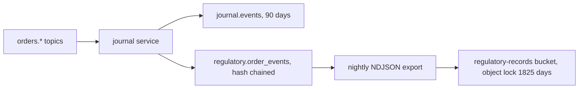

The platform is a simulator. It produces the data shapes, controls and evidence a regulated firm would keep under MiFID II, but it makes no claim of legal compliance and submits nothing to an Approved Reporting Mechanism.

## Regulatory identifiers on orders

The OMS stamps regulatory identifiers on `orders.submitted` and `orders.routed`. The EMS adds the algorithm identifier to `orders.filled`. The journal keeps the full payload of every event, so reports can be rebuilt from stored records.

| Field | Source | Notes |
| --- | --- | --- |
| `algoId`, `algoVersion` | `shared/algoRegistry.ts` | Set for algorithmic strategies only. `LIMIT` is not treated as an algorithm. |
| `orderType` | OMS | `LIMIT` when a limit price is present, otherwise `MARKET`. |
| `lei` | `FIRM_LEI` environment variable | Executing entity. Dropped unless it matches the 20 character LEI format. |
| `clientCode` | `users.trading_limits.client_code` | Pseudonymous code. Falls back to the user id. |
| `decisionMakerCode` | `users.trading_limits.decision_maker_code` | Investment decision within the firm. Falls back to the user id. |
| `executionDecisionCode` | OMS | The algorithm identifier when an algorithm executes the order, otherwise the decision maker code. |

No national identifiers are stored. Codes are pseudonyms that an operator maps to natural persons outside the platform.

## Algorithm registry

Every strategy has a registry entry with a stable identifier and a semantic version. Bump the version in `shared/algoRegistry.ts` whenever an algorithm's behaviour changes, so that fills and test records can be tied to the code that produced them.

## Journal behaviour

Fill events are keyed by execution id, so repeated partial fills of one child order are all retained. Previously only the first fill of a child was stored.

## Order record and retention

Every order lifecycle event (`orders.submitted`, `orders.routed`, `orders.child`, `orders.filled`, `orders.expired`, `orders.rejected`) is written twice by the journal service:

| Store | Purpose | Retention | Mutable |
| --- | --- | --- | --- |
| `journal.events` | Hot store for the UI, replay and latency metrics | 90 days (`JOURNAL_RETENTION_DAYS`) | Yes, pruned |
| `regulatory.order_events` | Legal order record | Not pruned | No |

`regulatory.order_events` follows the same pattern as `audit.events`. Rows form a SHA-256 hash chain, triggers reject `UPDATE`, `DELETE` and `TRUNCATE`, and the writer role can only insert and select. The journal writes through the existing `veta_audit` login, so no additional secret is introduced. Each row keeps the full event payload, including the regulatory identifiers stamped in the previous step.

The journal exports each completed UTC day to `orders/YYYY/MM/DD.ndjson` in the `regulatory-records` bucket every six hours, skipping days already present. The bucket is created with object lock and a default COMPLIANCE retention of 1825 days (five years). The export needs `MINIO_ENDPOINT`, `MINIO_ROOT_USER` and `MINIO_ROOT_PASSWORD` on the journal service and is disabled when they are absent.

Integrity checks are exposed by the journal at `/regulatory/verify` and `/regulatory/head`. The retention runbook is [Regulatory record retention](https://github.com/milesburton/veta-trading-platform/blob/main/docs/incidents/runbooks/regulatory-retention.md).

This is a simulation. Five year retention here means the controls exist and are tested, not that the deployment meets a regulator's availability or audit requirements. Postgres backups default to 14 days (`POSTGRES_BACKUP_RETENTION_DAYS`), so the object-locked export, not the backup, is the long-term copy.
